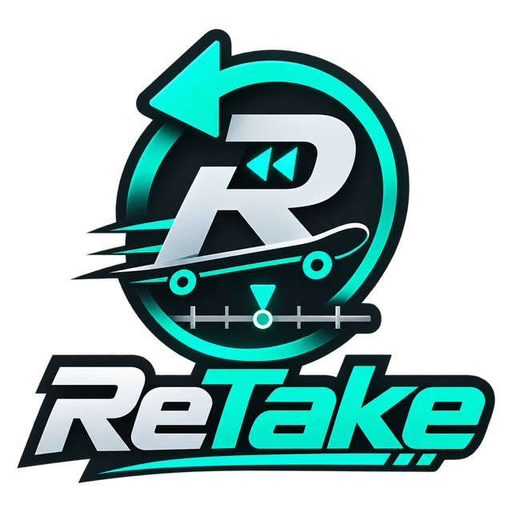
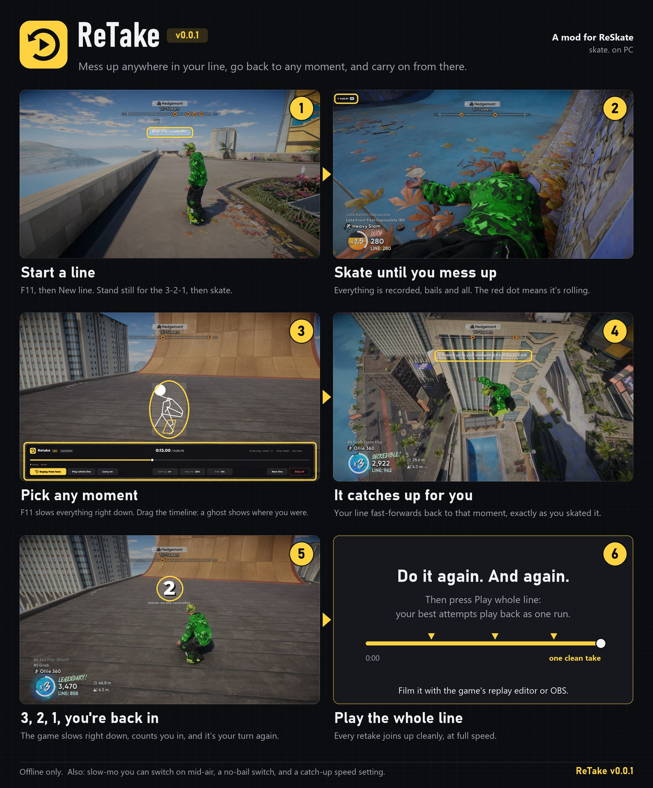

<p align="center">
  
</p>

<p align="center">
  <b>Mess up anywhere in your line, go back to any moment, and carry on from there.</b><br>
  A <a href="https://github.com/Dingo-Shenanigans/ReSkate">ReSkate</a> mod for skate. on PC. Offline only.
</p>

<p align="center">
  <a href="https://github.com/N0deNinja/ReTake/releases/latest"><b>Download</b></a> ·
  <a href="#install">Install</a> ·
  <a href="#how-to-use-it">How to use it</a> ·
  <a href="#known-issues">Known issues</a>
</p>

> [!WARNING]
> **This is version 0.0.6, an early release.** Sometimes a replay drifts away from what you actually skated, mostly on **rails, ledges and other grinds**. We're working on it. If it happens, go back to a moment a little earlier and try again.



## What it does

You skate a line. ReTake records it. When you mess up, open the timeline, pick any moment, and ReTake plays your line back up to that moment, exactly as you skated it. Then it counts you in and hands you the controls. Do that as many times as you like. At the end, **Play whole line** plays all your best attempts back as one run, which you can film with the game's replay editor or OBS.

- **Timeline (F11).** Slows the game down and shows your whole line. Scrub it and a ghost skater shows where you were.
- **Replay from here.** Fast-forwards your line to the moment you picked, slows down, counts 3, 2, 1, and you're back in.
- **Play whole line.** Plays every retake back as one run, at full speed.
- **Takes.** Every try is kept. Step back to an earlier take in the timeline and carry on from it, to combine the best parts.
- **Slow motion.** Click both sticks (L3 + R3) to switch it on and off, even mid-air, at full frame rate. The skater rides in it just as at full speed. Put it on any button you like, or turn the button off, with **Slow-mo key** in the timeline.
- **Bails off.** One switch so you don't fall off from big drops.
- **Stop all.** One button that stops everything ReTake is doing.
- **My lines.** Save your lines and come back to them later, even after closing the game. **Share** one by sending its `.retake` file.
- **Ghost lines (F10).** Make a ghost of your line and send it to friends. They see a pin where it starts, can **Watch** it through your camera, then **Try it** with your skater riding beside them as a ghost, in your outfit, with your name over it.
- **Report a problem.** Write what went wrong; ReTake saves it in a file with the last 30 seconds of the game, for us to look at.
- **Looks like the game.** ReTake's screens use skate.'s own menu style: its tiles, fonts and keycaps.

## Install

You need:

- skate. on PC (Steam or EA app)
- [ReSkate](https://github.com/Dingo-Shenanigans/ReSkate/releases) **2.1.4-2**, started once so it has made its settings

Then:

1. Download **`ReTake-v0.0.6.zip`** from [Releases](https://github.com/N0deNinja/ReTake/releases/latest) and unzip it anywhere.
2. Close skate. and the ReSkate launcher.
3. Double-click **`Install ReTake.bat`**.
   It finds your game on its own (or lets you pick the folder), backs up your `ReSkate.dll`, installs ReTake, and asks to turn off the launcher's automatic updates.
4. Start skate. with the ReSkate launcher as usual and play **offline**.
5. The first time, ReSkate asks you to allow ReTake's permissions. Allow them.
6. Press **F11** and pick **New line**.

> [!NOTE]
> ReTake needs its own build of `ReSkate.dll` (the plugin API doesn't have rewinding yet). When the ReSkate launcher updates, it puts the official `ReSkate.dll` back, which removes ReTake. That's why the installer turns automatic updates off. If you'd rather keep them on, run `Install ReTake.bat` again after each update.

If Windows SmartScreen warns about the `.bat`, choose **More info**, then **Run anyway**. The installer only touches your skate. folder: `ReSkate.dll`, `Mods\ReTake`, a `ReTake-backup` folder, and the `"updates"` line in `ReSkateLauncher.settings.json`.

<details>
<summary>Installing by hand</summary>

1. Close the game and the launcher.
2. Back up `ReSkate.dll` in your skate. folder.
3. From the zip's `files` folder, copy `ReSkate.dll` into your skate. folder, and `Mods\ReTake` into its `Mods` folder.
4. In `ReSkateLauncher.settings.json`, set `"updates": false`.

</details>

### Updating

Download the new zip, close the game, and double-click **`Install ReTake.bat`** again. It finds the folder ReTake is in, updates it without asking anything, and keeps your original `ReSkate.dll` backup. ReSkate then asks you to allow ReTake again, because its files changed.

### Uninstall

Close the game and double-click **`Uninstall ReTake.bat`**. It puts your old `ReSkate.dll` back, removes `Mods\ReTake`, and turns launcher updates back on.

## How to use it

1. **Start a line.** Stand where your line begins. Press F11, then **New line**. Stand still for the 3, 2, 1, then skate.
2. **Skate until you mess up.** Everything is recorded, bails included. The red dot in the corner means it's recording.
3. **Pick a moment.** Press F11. The game slows right down and the timeline opens. Drag along it; the ghost shows where you were.
4. **Replay from here.** Your line fast-forwards back to that moment, exactly as you skated it.
5. **3, 2, 1, you're back in.** The game slows down, counts you in, and hands you the controls. Your new attempt replaces the rest of the line.
6. **Play whole line.** When you're happy, play it back as one run and film it.

### Controls

| | |
|---|---|
| **F11** | Open or close the timeline |
| **F10** | Open or close Ghost lines; stop watching or trying one |
| **Drag, mouse wheel, ← / →** | Scrub the timeline |
| **Enter** | Replay from the picked moment |
| **Esc** | Close the timeline |
| **L3 + R3** (click both sticks) | Slow motion on and off (change it with **Slow-mo key**) |
| **Ctrl + R** | Go back 1 second (press again to go further) |

### Ghost lines

1. **Make one.** Skate a line (retakes and all), press **F10** and click **Make a ghost of my line**. The line plays once, hands off, while ReTake records your skater, your outfit and your camera. First it asks for a title and the name shown over your skater, both filled in already (your Steam name).
2. **Share it.** Click **Open folder** and send the `.ghost` file. Whoever gets it puts it in the same folder (`Mods\.reskate_plugin_data\ReTake\ghosts`).
3. **Find it.** A tag floats over the start of each ghost line on the map you're on, with its distance, and ReTake tells you when you're close. The F10 window lists them nearest first, with a map of the ones around you. One on another map travels there first. Too many tags? **Floating labels** at the bottom of the window shows them all, only the near ones, or none.
4. **Watch** it through its skater's camera, then **Try it**: you start where they started, at their speed, after 3, 2, 1, with their skater riding beside you as a ghost. The ghost doesn't collide with you.

### In the timeline

| Button | What it does |
|---|---|
| **Replay from here** | Go back to the picked moment and carry on from there |
| **Play whole line** | Play the whole line back as one run |
| **Carry on** | Close the timeline and keep skating |
| **Catch-up** | How fast the replay fast-forwards (1× to 8×) |
| **Slow-mo** | How slow slow motion is |
| **Bails** | The game's bails on or off |
| **Slow-mo key** | Click it, then press the buttons you want for slow motion and let go. Click it twice for no button |
| **New line** | Throw this line away and start a new one (press twice) |
| **Stop all** | Stop everything ReTake is doing |
| **< Take 2 of 3 >** | Top right, once you've retaken: step between your tries and carry on from any of them |
| **My lines** | Top right: save this line, load, share or delete a saved one |
| **Report a problem** | Top right: write what went wrong and save it to a file you can send us |

### Console

Open the ReSkate console and type `retake` to see all of these:

```
retake new                start a new line where you stand
retake save [name]        save the line, to come back to it after closing the game
retake lines              your saved lines, numbered (also: F11, My lines)
retake load <number>      load a saved line, in place of the one you have
retake delete <number>    delete a saved line
retake ghosts             ghost lines: other skaters' lines to watch and try (also: F10)
retake ghosts labels [all|near|off]  the floating labels over ghost line starts
retake ghost make [name]  make a ghost line of your line, to share (it plays once, hands off)
retake ghost watch <n>    watch a ghost line through its skater's eyes
retake ghost try <n>      try a ghost line, its skater riding beside you
retake ghost stop         stop watching or trying
retake name [name]        the name on the ghost lines you make; alone, says it
retake back [seconds]     go back that far (default 1)
retake whole              play the whole line as one run
retake slowmo [0.05-0.9]  slow motion on and off, or how slow (default 0.25)
retake slowmo key [combo] the slow-motion button: Pad.LB+Pad.RB, Ctrl+K, off or default; alone, says it
retake speed [1-8]        how fast going back catches up (default 4)
retake bails              the game's bails off and on
retake stop               stop everything ReTake is doing
retake off                stop recording and forget the line
retake report             report a problem: write what went wrong, saved with the game's state
retake files              open ReTake's log folder
retake ease [on|off]      speed changes ease in (on, the default) or happen at once
retake slowtest [m:ss]    test slow motion at that moment of the line (replaces what comes after)
retake skatertest         stand still: the skater is rebuilt at full speed and in slow motion, and saved each time
```

The last two are for tracking down bugs; you won't need them to skate. `retake` alone also lists a few research commands (`statetest`, `ghosttest`, `warmtest`).

## Known issues

- **Replays can drift, mostly on rails and ledges.** The game's grind logic doesn't always come out the same way twice, so a replayed line can end up somewhere slightly different from the original. Going back to a moment a bit earlier usually works. We're working on making it exact.
- **Start your lines on the board.** A line begun on foot can come out differently after the game is restarted, because ReTake can't hold a skater on foot to the recording. Get on your board before New line.
- **Offline only.** ReTake refuses to run in a multiplayer session, by design.
- **Only for ReSkate 2.1.4-2** and the skate. build it supports. A new ReSkate version needs a new ReTake build.
- **Lines can be up to 10 minutes long.**
- **Found a bug?** Right after it happens, press F11 and click **Report a problem** (top right), write what went wrong, and press **Save report**. ReTake saves a file in `Mods\.reskate_plugin_data\ReTake\reports` with what you wrote and the last 30 seconds of the game. Attach it to an [issue](https://github.com/N0deNinja/ReTake/issues). ReTake never sends anything by itself.

## What's in this repository

| Folder | What's in it |
|---|---|
| `mod/ReTake` | The ReSkate plugin (Luau): the timeline, the controls, the UI |
| `installer` | `Install ReTake.bat`, `Uninstall ReTake.bat` and the PowerShell scripts behind them |
| `native` | The full source of ReTake's `ReSkate.dll`: ReSkate 2.1.4-2 plus ReTake's changes (`native/RETAKE.diff` lists them) |
| `tools` | `make-release.ps1`, which builds the release zip |
| `docs` | Images for this page |

## Building

You need Visual Studio 2022 (or its Build Tools) with the C++ workload, and CMake.

```bat
cd native
cmake -S . -B build/vs2022-x64 -DDINGOSDK_CRASH_REPORT_URL=
cmake --build build/vs2022-x64 --config Release --target dingosdk_runtime dingosdk_plugin_tests
ctest --test-dir build/vs2022-x64 -C Release -R plugins
cd ..
powershell -ExecutionPolicy Bypass -File tools\make-release.ps1
```

That writes `dist\ReTake-v0.0.6.zip`.

ReTake's changes to ReSkate, in short: a `reskate.tas` plugin API that records a line's inputs per physics step and replays them locked to the recording, game-time control for the catch-up and the countdown, slow motion that keeps the skater as the game would build it at the shorter step (the board's flight, the joints and everything else worked out from the step length) so it rides the same, a no-bail switch, ghost lines (the skater's pose, camera and outfit at every step, compressed the way multiplayer sends a player, and shown as a multiplayer player model), sharper plugin fonts, and **no crash reports**: this build never uploads anything.

## Credits and licence

- Built on [ReSkate](https://github.com/Dingo-Shenanigans/ReSkate) by Dingo Shenanigans, which is GPL-3.0. ReTake is GPL-3.0 too; see [LICENSE](LICENSE).
- ReTake is a fan project. It is not made by, or affiliated with, EA, Full Circle or the ReSkate team. Please don't report ReTake bugs to them.
